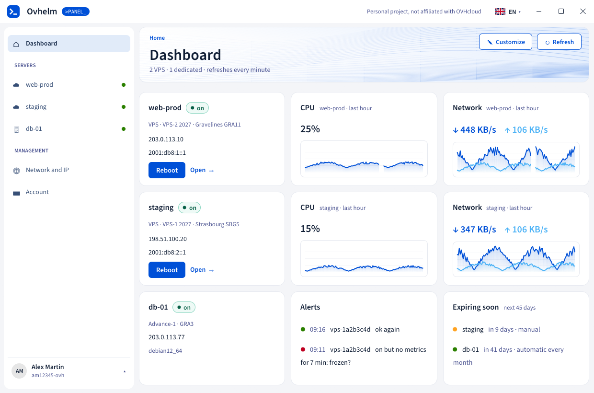
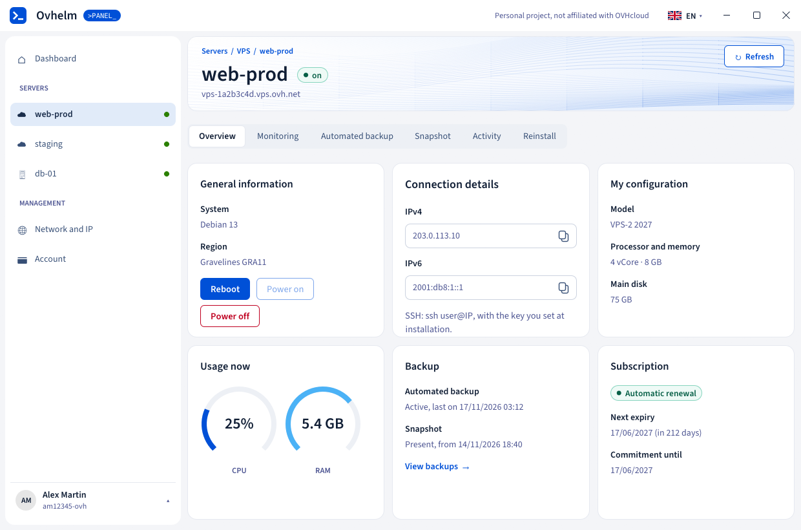
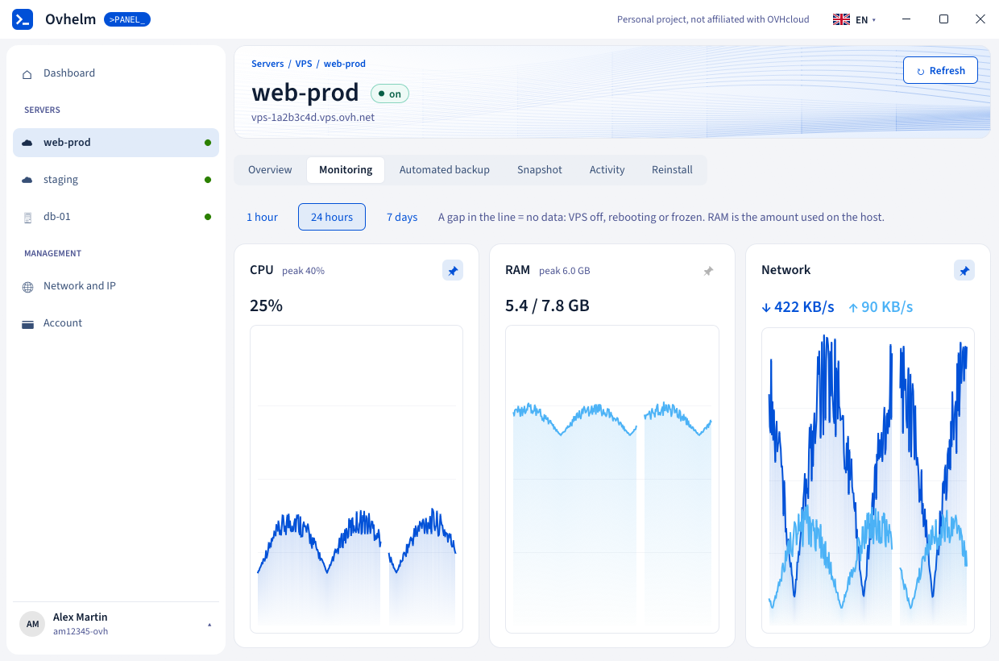
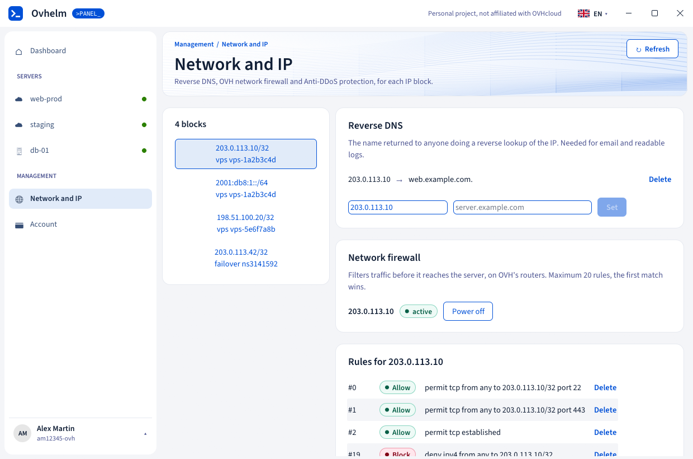
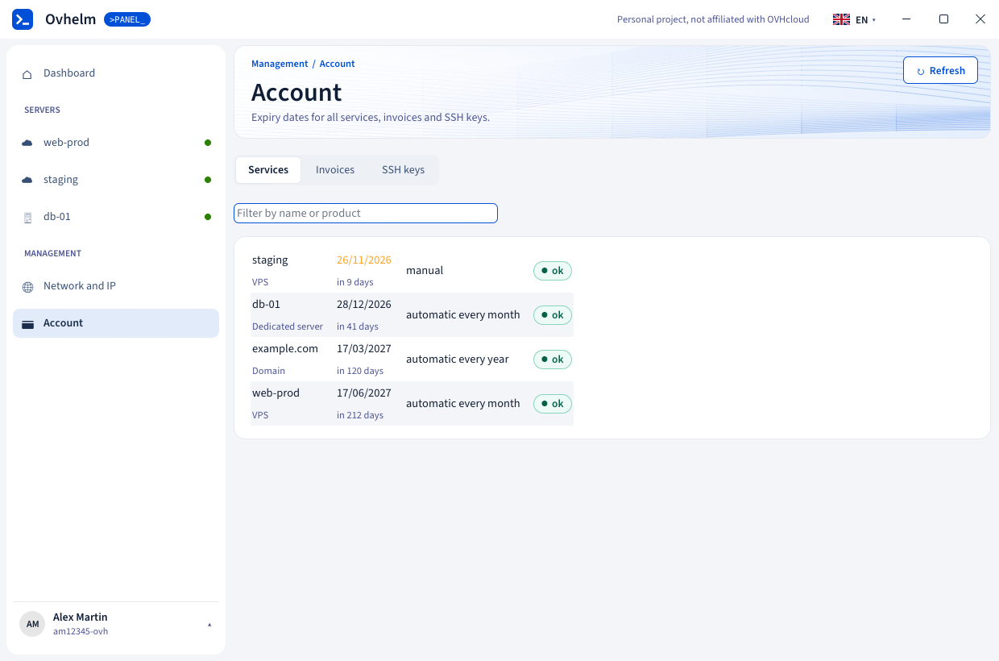
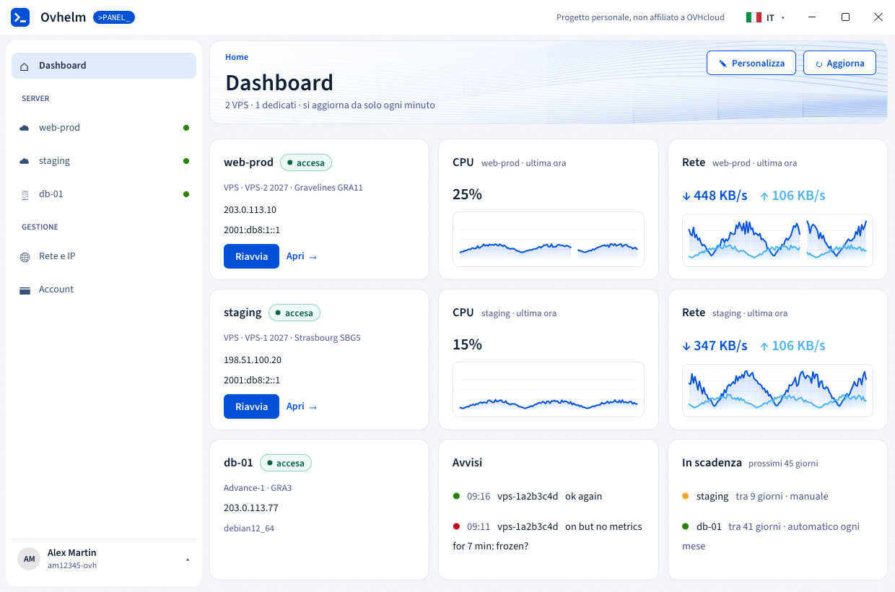

<p align="center">
  
</p>

<h1 align="center">Ovhelm</h1>

<p align="center">
  <b>Your OVHcloud VPS and dedicated servers in a Windows app.</b><br>
  Status, charts, backups, firewall, invoices, and a tray alert when a server stops answering.
</p>

<p align="center">
  <a href="https://github.com/thadoom/ovhelm/releases/latest"></a>
  <a href="https://github.com/thadoom/ovhelm/releases"></a>
  
  <a href="LICENSE"></a>
</p>

> [!IMPORTANT]
> Ovhelm is a personal project. It is **not an OVHcloud product** and has no connection with OVHcloud, which does not support it and is not responsible for it. It uses the public OVHcloud API with your own keys.



I built Ovhelm because checking whether my VPS had frozen meant logging into the OVHcloud manager every time. Now the app sits in the tray, and when a server stops answering, Windows tells me. The look follows OVHcloud's new console, so nothing feels out of place.

## Download

**[⬇ Download ovhelm.exe](https://github.com/thadoom/ovhelm/releases/latest/download/ovhelm.exe)** (about 6 MB). Windows 10 or 11, one file, nothing to install, no admin rights.

Every build is made by [GitHub Actions](.github/workflows/release.yml) from this repository, scanned with Microsoft Defender, and listed with its SHA-256 and VirusTotal report at the bottom of the [release notes](https://github.com/thadoom/ovhelm/releases/latest). Code signing through SignPath Foundation is on its way (see [Code signing policy](#code-signing-policy)); until then SmartScreen may show "Windows protected your PC": click **More info**, then **Run anyway**.

## First start

1. Open `ovhelm.exe` and click **Create them on OVHcloud**. It opens the OVHcloud page that makes API keys.
2. Log in, give the application a name, choose a validity (**Unlimited** never expires) and confirm.
3. Paste the three keys into Ovhelm and press **Save and connect**.

That's it: your servers show up on the left and the dashboard fills in.

## What you get

| | |
|---|---|
|  |  |
| **Every VPS in one page.** Reboot, power on and off, KVM console, OS reinstall with your SSH key, automated backups and snapshots, subscription and renewal. | **CPU, RAM and network** for the last hour, day or week. A gap in a line means OVHcloud got no data: the server was off, rebooting or frozen. |
|  |  |
| **Network and IP.** Reverse DNS, the OVH network firewall with its 20 rules, anti-DDoS status, for every IP block. | **Account.** Every service with its expiry date and renewal mode, invoices with the PDF, the SSH keys stored on your account. |

Also in there:

- **A dashboard you put together.** Click **Customize**, or the 📌 on any chart, and pick what to watch: CPU, RAM, network, status, backups, alerts, renewals, invoices. The tiles share the window, no scrolling.
- **Dedicated servers.** Hardware and disks, bandwidth and traffic, boot and rescue mode, IPMI console, OVH monitoring on or off, OS reinstall.
- **Tray alerts.** Closing the window keeps Ovhelm running in the tray. Every minute it checks every server and sends a Windows notification when one goes down, stops sending metrics for 7 minutes, or comes back.
- **Seven languages.** English, Italiano, Français, Deutsch, Español, Polski, Português. The flag button at the top right switches them; the first start follows your Windows language.
- **Safe by default.** Anything that destroys data (restoring a backup or snapshot, reinstalling) asks twice and wants the server name typed in.
- **Light.** About 90 MB of RAM and 0% CPU when idle; the animated header costs about 7% of one core, and only while the window has focus.

<p align="center"></p>

## Security and privacy

- Your keys are saved in the **Windows Credential Manager** (entry `Ovhelm`), never in a file and never sent anywhere except OVHcloud. **Sign out** in the account menu at the bottom left deletes them.
- Ovhelm connects only to the OVHcloud API (`eu.api.ovh.com`) and to the OVHcloud metrics endpoint that the API itself hands out for your VPS. No telemetry, no analytics, no update checks, no other servers.
- Links you click (KVM or IPMI console, invoice PDFs, the key page) open in your browser.
- Pins and the language you picked are kept in `%APPDATA%\Ovhelm`. Nothing secret is stored there.

**About the keys.** The **Create them on OVHcloud** link asks for access to the whole API (`GET/POST/PUT/DELETE /*`), so you create the keys once and they keep working as Ovhelm grows. Ovhelm never orders, pays or cancels anything, but whoever holds those keys could: treat them like your OVHcloud password.

If you prefer narrower keys, create them by hand on [eu.api.ovh.com/createToken](https://eu.api.ovh.com/createToken/) with these rules (sections Ovhelm cannot read will tell you):

```
GET  /vps  /vps/*            POST /vps/*   PUT /vps/*   DELETE /vps/*
GET  /dedicated/server  /dedicated/server/*            POST /dedicated/server/*   PUT /dedicated/server/*
GET  /ip  /ip/*              POST /ip/*    PUT /ip/*    DELETE /ip/*
GET  /service  /service/*  /me  /me/bill  /me/bill/*
GET  /me/sshKey  /me/sshKey/*               POST /me/sshKey              DELETE /me/sshKey/*
```

## FAQ

**Is this made by OVHcloud?** No. It's an independent open-source project that uses the public API. The colors follow OVHcloud's design system ([ODS](https://github.com/ovh/design-system), Apache 2.0) so the screens look familiar; the name and logo are different.

**Does it work outside Europe?** Not yet. Ovhelm talks to `eu.api.ovh.com`, so it works with accounts created on the European OVHcloud sites. Canada and US accounts use other endpoints.

**Why is the RAM so high on an idle server?** On recent VPS models OVHcloud does not expose memory from inside the server. Ovhelm shows what the virtual machine occupies on the host, and that includes the guest's disk cache. It's useful for spotting spikes and drops, not for knowing what your processes use.

**My antivirus complains.** New, unsigned executables trip some heuristics. Each release lists its VirusTotal report; you can also build from source (below) and compare the SHA-256. Signed builds will follow once SignPath approves the project.

**Linux or macOS?** No: credentials, tray, notifications and the window frame use Windows APIs.

## Build from source

You need [Rust](https://rustup.rs/) (stable) on Windows.

```
git clone https://github.com/thadoom/ovhelm
cd ovhelm
cargo build --release
```

The exe is `target\release\ovhelm.exe`.

- `cargo test` checks the OVHcloud request signature against vectors computed separately with `sha1sum`, date and URL handling, and that every language file has every key and placeholder.
- `cargo test -- --ignored` also runs two live checks: fake keys against OVHcloud (must answer `403: This application key is invalid`) and the metrics of your first VPS with the keys Ovhelm saved (read-only).
- `ovhelm.exe --demo` opens the app with made-up servers, no account needed. Add `--page dashboard|vps|monitor|network|account|bills|dedicated` and `--lang en|it|fr|de|es|pl|pt` to jump somewhere; the screenshots above come from it.

<details>
<summary><b>How it talks to OVHcloud</b></summary>

- Authentication: application key, application secret and consumer key, with the `$1$` + SHA-1 request signature and the clock taken from `/auth/time`. OAuth2 service accounts were skipped: they need an IAM policy and a token renewed every hour.
- VPS metrics: on recent models (tested on a VPS-2 2027) `/vps/{serviceName}/monitoring` answers 500 and `/vps/{serviceName}/status` answers `403: not implemented`. The real numbers come from Mimir (Prometheus): `GET /vps/{serviceName}/metricsToken` returns an endpoint and a token, and every query has to filter on `service_name="<serviceName>"` or Mimir rejects it. Series used: `rec_libvirtd_domain_cpu_usage`, `rec_libvirtd_domain_balloon_rss` and `balloon_current`, `rec_libvirtd_domain_net_rx_bytes` and `net_tx_bytes`. The token is reused for 10 minutes: asking for one per chart gets requests refused.
- The window has no Windows title bar: the header draws its own minimize, maximize and close buttons, and DWM rounds the corners.
- V-sync is off and frames are capped at 60 per second by hand. With v-sync on, the GPU driver busy-waits for the monitor; an early build sat at 54% of a core doing nothing.

</details>

## Known limits

- Live-tested on one VPS. Dedicated servers, firewall rules and some IP features follow the OVHcloud OpenAPI schema but haven't met a real account yet: if something breaks, [open an issue](https://github.com/thadoom/ovhelm/issues) with the error text.
- The IPMI console doesn't send `ipToAllow`; if OVHcloud requires it for your server, the error appears bottom right.
- How `cpu_usage` scales with several vCores (whether it can go above 100) is not documented; Ovhelm draws it as a percentage.
- Restoring an automated backup always restores the whole disk.

## Translations

One file per language in [`lang/`](lang), lines like `vps.riavvia = Reboot`. `{name}` is a placeholder and must stay as it is. Italian (`it.lang`) is the source text; a missing key falls back to English, then Italian. Corrections and new languages are welcome as pull requests: `cargo test` tells you if a key or placeholder is missing.

## Code signing policy

Windows builds of Ovhelm are going to be signed through **SignPath Foundation**, which provides free code signing for open-source projects. The request is pending; until it is approved, releases are unsigned. Once approved this section will read: *Free code signing provided by [SignPath.io](https://about.signpath.io/), certificate by [SignPath Foundation](https://signpath.org/).*

- Only builds made by the [release workflow](.github/workflows/release.yml) from this public repository are signed. Nothing built on a personal computer is.
- Committers and reviewers: [thadoom](https://github.com/thadoom)
- Approvers: [thadoom](https://github.com/thadoom)
- Privacy: Ovhelm doesn't send any information to other networked systems unless the user asks for it. With the keys the user enters, it connects only to the OVHcloud API and to the metrics endpoint that API provides. See [Security and privacy](#security-and-privacy).

## License

[MIT](LICENSE). Source Sans 3 in `assets/fonts` is under the SIL Open Font License ([OFL.md](assets/fonts/OFL.md)).
